# Bilingual AI Water Complaint Assistant

**Bangla · English** &nbsp;|&nbsp; AI voice reporting &nbsp;|&nbsp; Netlify + Groq Whisper

*In-app Bangla name: জলসেবা সহায়ক (WaterCare Assistant)*

A bilingual (Bangla / English) web app with an AI voice assistant for reporting and tracking water supply complaints in buildings, apartment complexes and neighbourhoods. People can report a problem by typing or by **recording a short voice message**. An AI speech-recognition model (Groq Whisper) transcribes the recording, the complaint form fills itself in, and the person reviews it before submitting. Staff can then track and update every complaint from an administrator view, and the whole interface switches between Bangla and English with one click.

> Built as a lightweight demo: no database and no build step. Reports are kept in the browser (see [Limitations](#limitations)).

## Screenshots

Every screen works in both languages. Bangla on the left, English on the right.

| বাংলা | English |
| --- | --- |
| 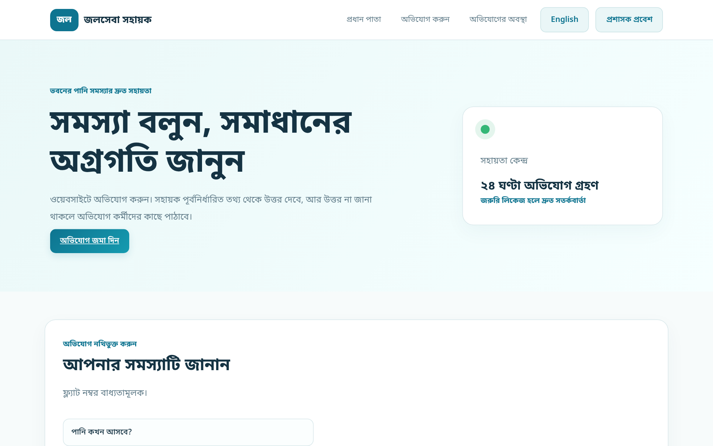 | 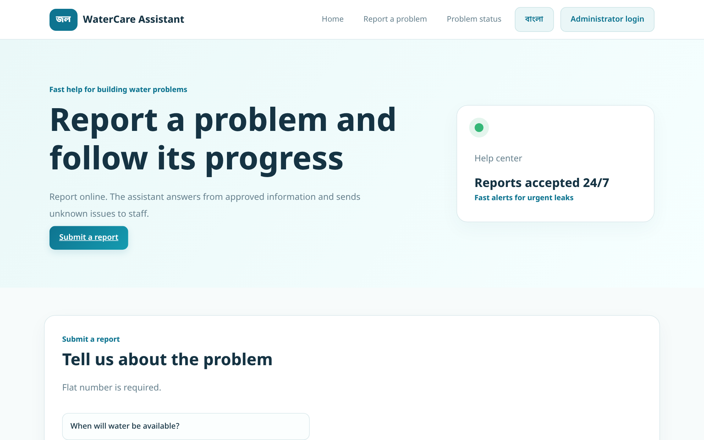 |
| 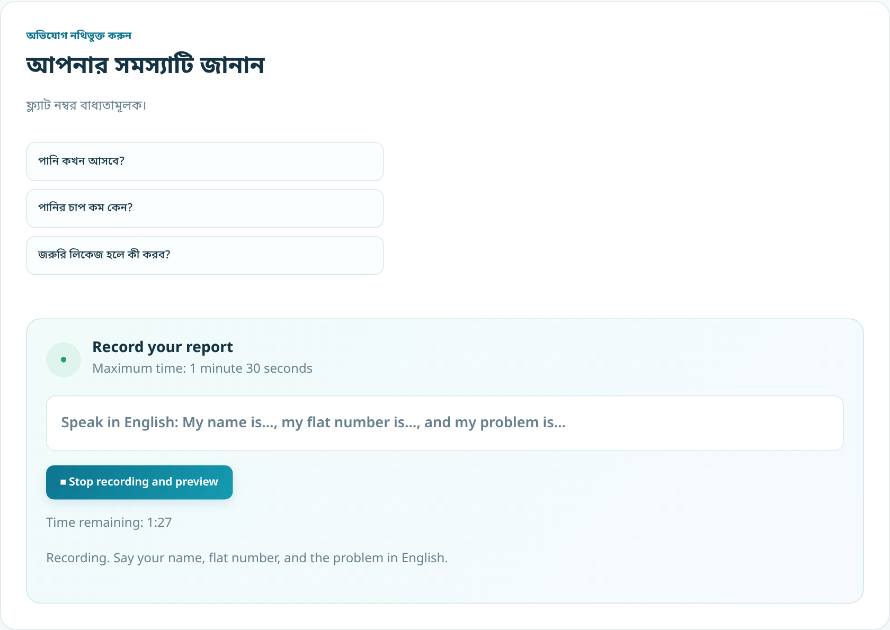 | 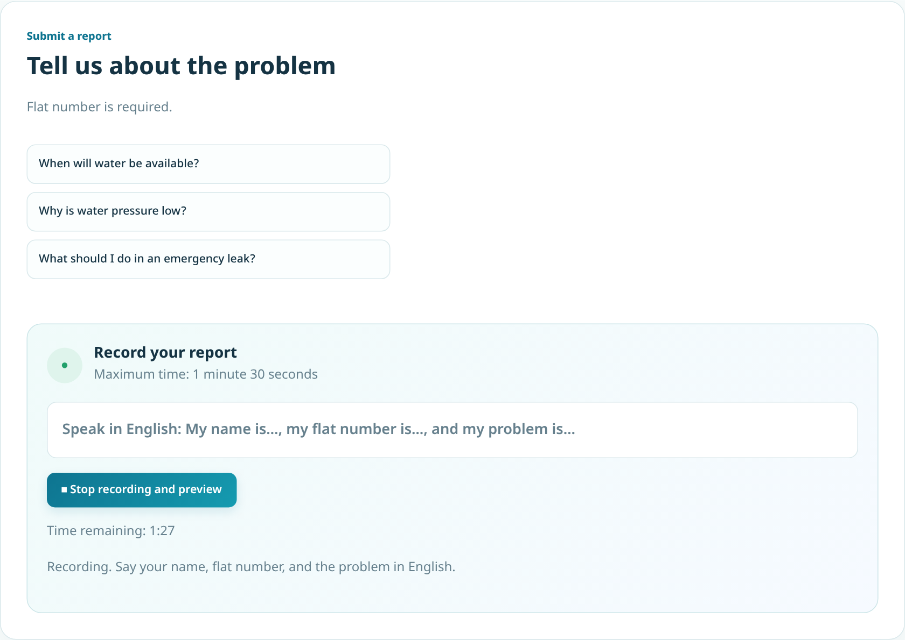 |
| 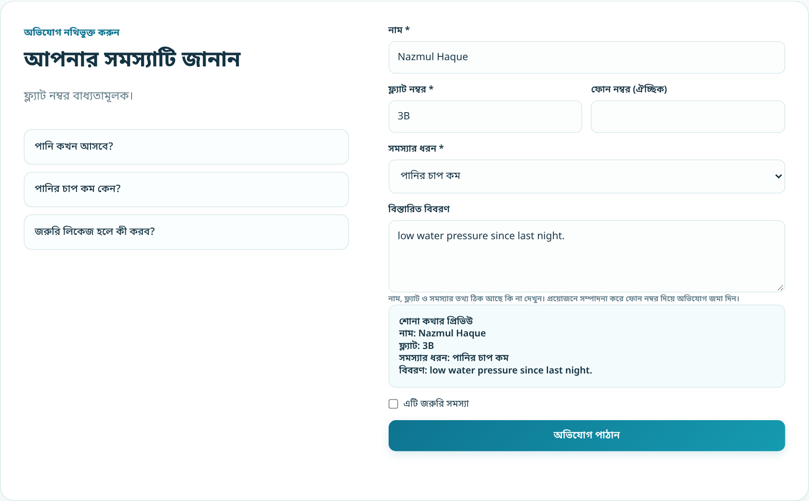 | 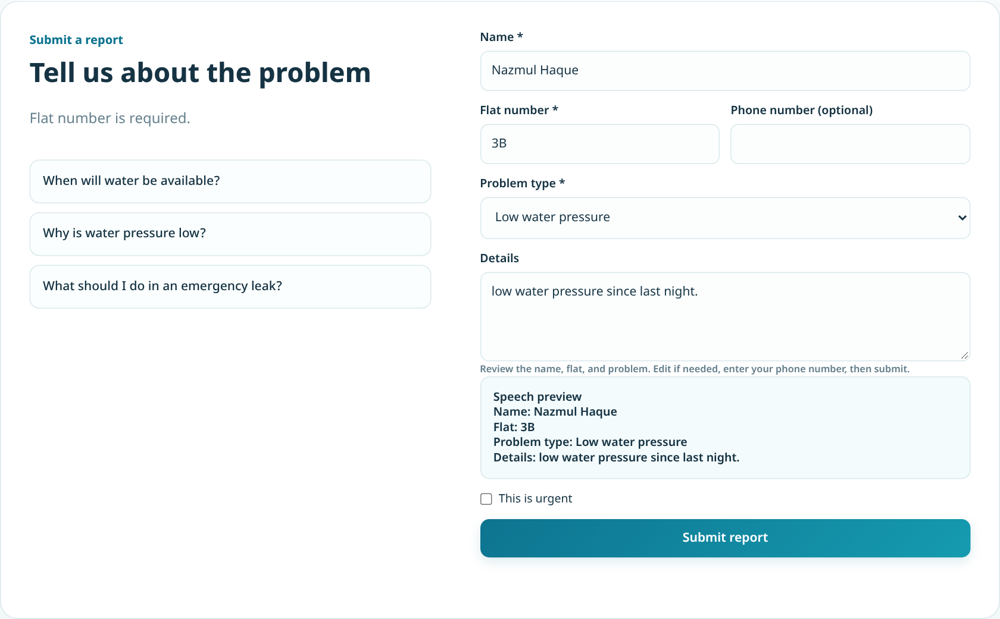 |
| 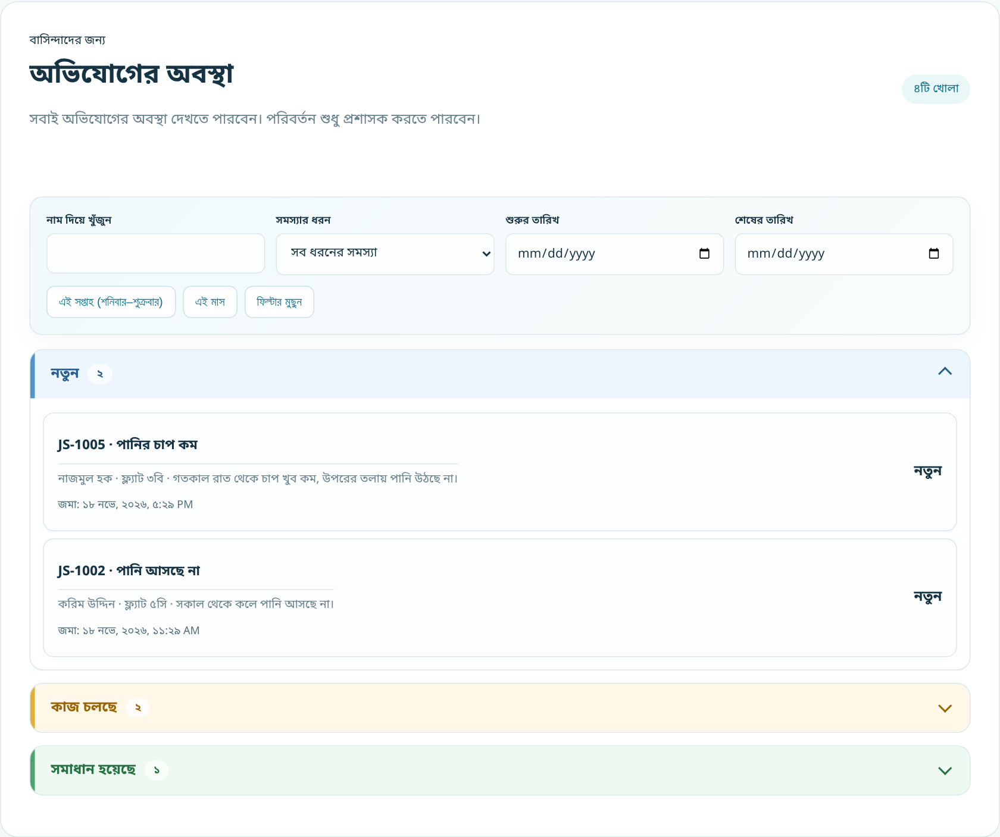 | 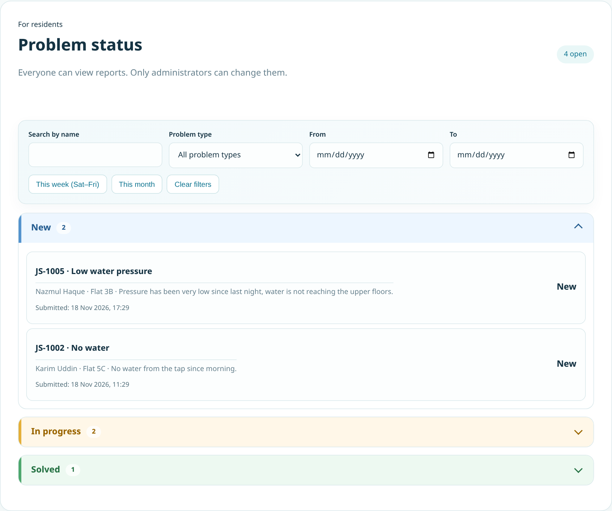 |
| 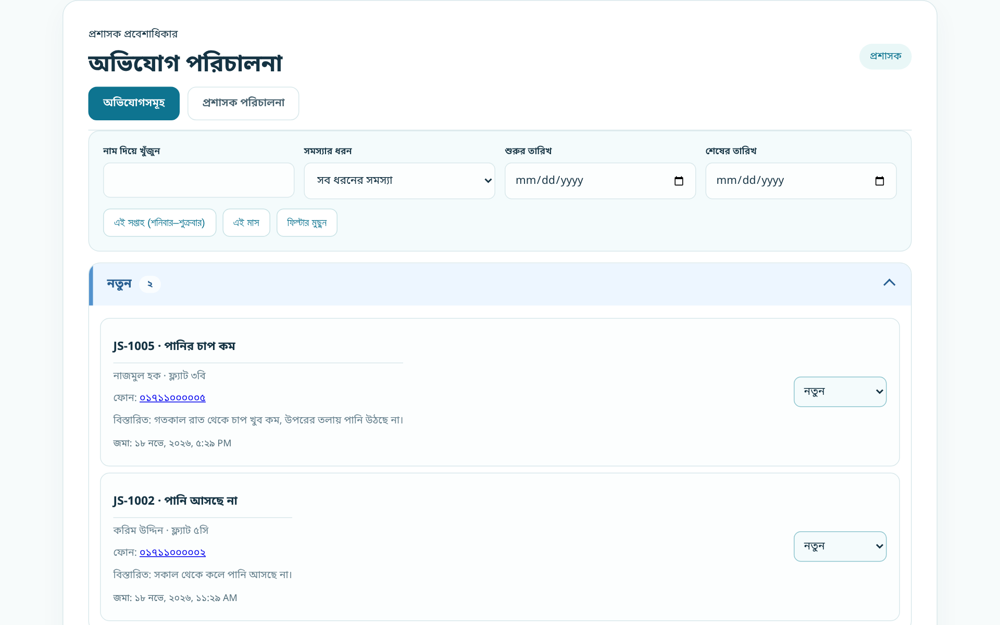 | 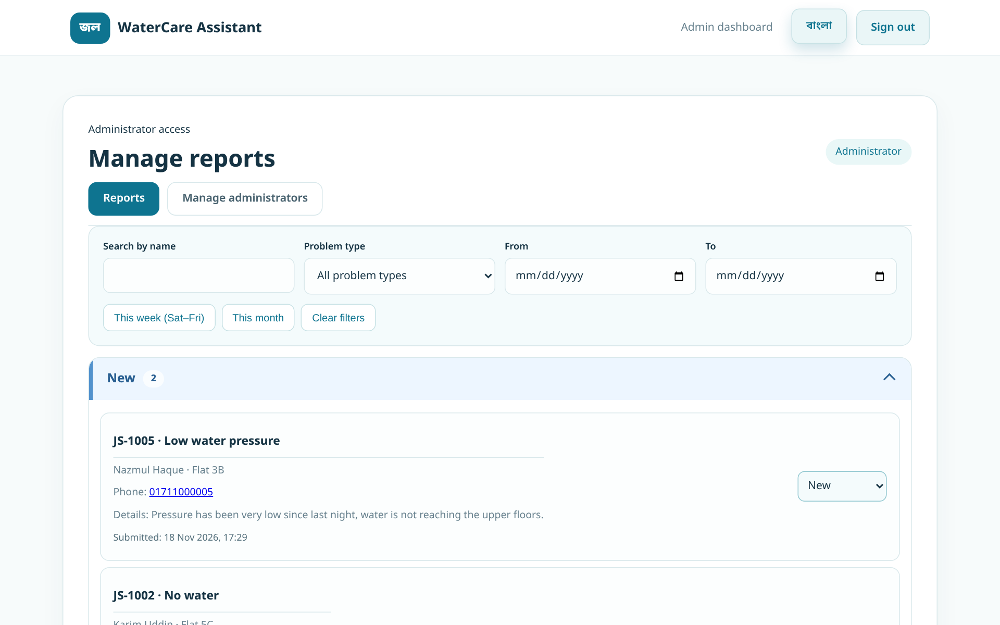 |
| 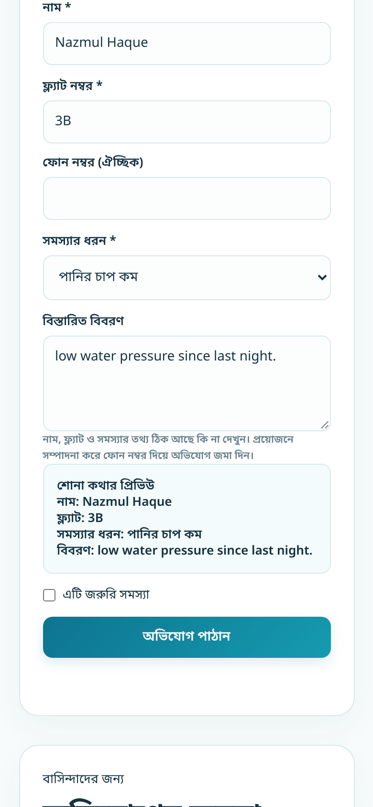 | 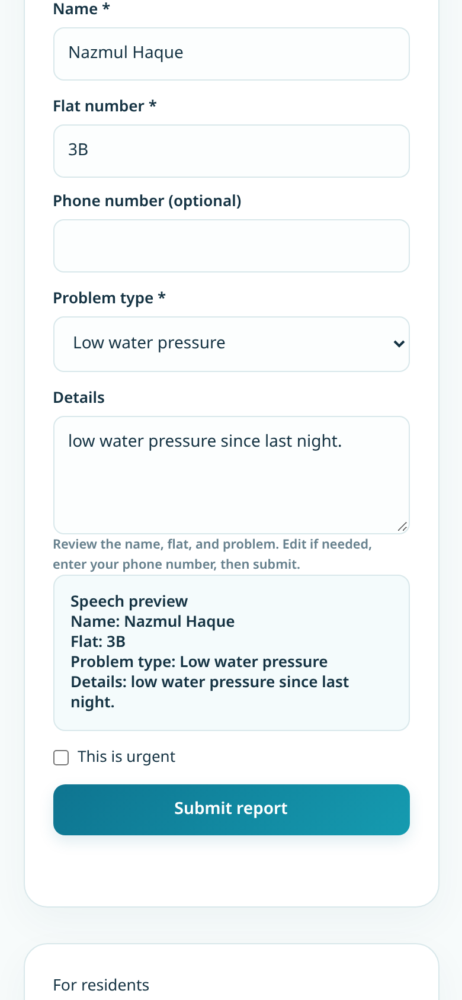 |

*Screenshots use sample data.*

## Features

- **Report by voice.** Record up to 90 seconds saying your name, flat number and problem. The name, flat, problem type and details are filled in for you to check.
- **Report by typing.** A simple form with the flat number required and an option to mark the problem as urgent.
- **Quick answers.** FAQ buttons answer common questions such as when water arrives and what to do about a leak.
- **Report status for everyone.** Residents can see where each report stands.
- **Administrator tools.** Sign in to change report status and manage administrator accounts.
- **Bangla and English.** One click switches the whole interface.
- **Responsive.** Works on phones and desktops.

## How voice reporting works

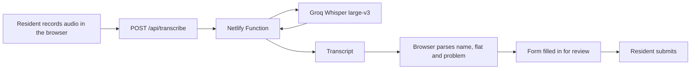

1. The browser records audio with the `MediaRecorder` API.
2. The clip is sent to `/api/transcribe`, a Netlify Function. The function holds the Groq API key, so the key is never exposed to visitors.
3. Groq Whisper (`whisper-large-v3`) returns the transcript.
4. The page picks out the name, flat number and problem from the text and fills the form.
5. The resident checks the result, adds a phone number if wanted, and submits.

For the best results, speak in English and follow this pattern: *"My name is …, my flat number is …, and my problem is …"*.

## Tech stack

| Part | Technology |
| --- | --- |
| Frontend | Plain HTML, CSS and JavaScript (no framework, no build) |
| AI speech to text | [Groq](https://groq.com) Whisper `whisper-large-v3` |
| Backend | One [Netlify Function](https://docs.netlify.com/functions/overview/) |
| Hosting | Netlify |

## Project structure

```
.
├── public/                    The website (the only folder that is published)
│   ├── index.html
│   ├── style.css
│   └── app.js
├── docs/
│   └── screenshots/           Images used in this README
├── netlify/
│   └── functions/
│       └── transcribe.js      Sends audio to Groq and returns the transcript
├── netlify.toml               Netlify settings and the /api/transcribe route
├── .env.example               Template for the API key
├── package.json               Shortcut for running locally
└── README.md
```

## Run it locally

You need [Node.js 18+](https://nodejs.org) and a free [Groq API key](https://console.groq.com/keys).

```bash
# 1. Get the code
git clone https://github.com/ShahriarKhanLimon/bilingual-ai-water-complaint-assistant.git
cd bilingual-ai-water-complaint-assistant

# 2. Add your key
cp .env.example .env        # on Windows: copy .env.example .env
# then open .env and paste your Groq key after GROQ_API_KEY=

# 3. Start the site together with the function
npm run dev
```

Open the address that Netlify prints (usually `http://localhost:8888`) and allow the microphone when asked.

> Open the site through that address. Double-clicking `index.html` will not work, because the voice feature needs the function.

## Deploy to Netlify

1. Push this project to GitHub (see below).
2. In Netlify choose **Add new site → Import an existing project** and select the repository.
3. Leave the build command empty. The publish folder (`public`) and the functions folder are read from `netlify.toml`.
4. Before the first deploy, open **Site configuration → Environment variables** and add `GROQ_API_KEY` with your key.
5. Deploy. Every later `git push` to `main` redeploys automatically.

After adding or changing an environment variable, run **Deploys → Trigger deploy**, because a new deploy is needed for the function to pick it up.

### Push to GitHub

Create an empty repository on GitHub first (no README, no .gitignore), then:

```bash
git init
git add .
git status                   # check that .env is NOT in the list
git commit -m "Initial commit: Bilingual AI Water Complaint Assistant"
git branch -M main
git remote add origin https://github.com/ShahriarKhanLimon/bilingual-ai-water-complaint-assistant.git
git push -u origin main
```

## Configuration

| Variable | Required | Description |
| --- | --- | --- |
| `GROQ_API_KEY` | Yes, for voice reports | Groq API key used by the Netlify Function. Typing a report works without it. |

## Limitations

This is a demo, and these points matter before real use:

- **Reports are stored in each visitor's own browser** (`localStorage`). A report made on one phone is not visible on another device, and an administrator will not see reports made by residents on their own devices. A shared database is needed for real use.
- **Administrator sign-in is not secure.** The accounts and PINs live in the page's JavaScript and in the browser, so anyone who views the source can read them. Treat it as a demo screen, not as protection. Change the seeded account and do not reuse a real PIN.
- **Voice works best in English.** The page looks for phrases such as "my name is" and "flat number", so other wording can leave fields empty. Residents can always correct the form before submitting.
- **Problem type is matched by keywords.** The page looks for words such as "no water", "low pressure" and "leak". If none match, the type falls back to "Other problem" and the resident can change it before submitting.
- **Audio leaves your server.** Recordings are sent to Groq for transcription and are not stored by this app. Mention this to residents and check Groq's current terms and free-tier limits for your use.
- **The function is public.** Anyone who finds `/api/transcribe` can call it and use your Groq quota. Watch usage in the Groq console, and add rate limiting before a public launch.

## Roadmap

- Store reports in a shared database so staff can see every report
- Real administrator authentication
- Smarter field extraction so residents can speak naturally in Bangla or English
- Notifications to staff for urgent reports

## Author

Made by [Shahriar Khan Limon](https://github.com/ShahriarKhanLimon).
